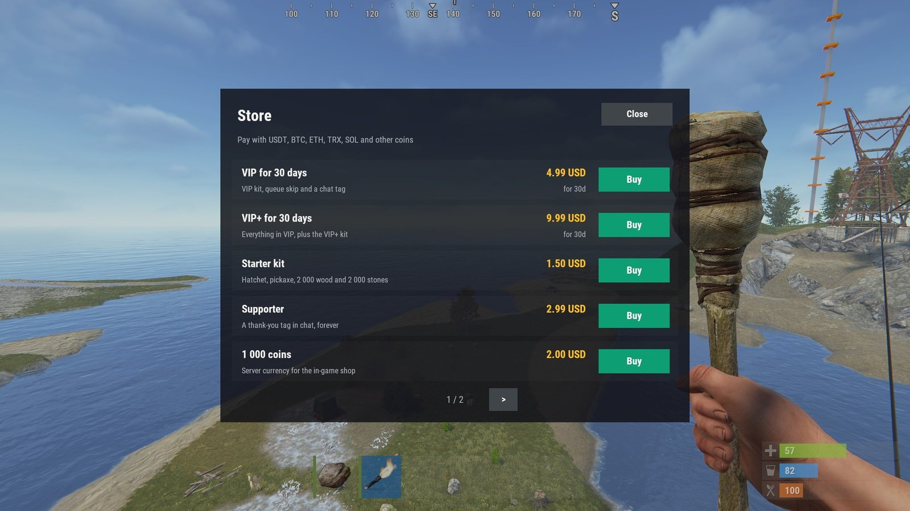
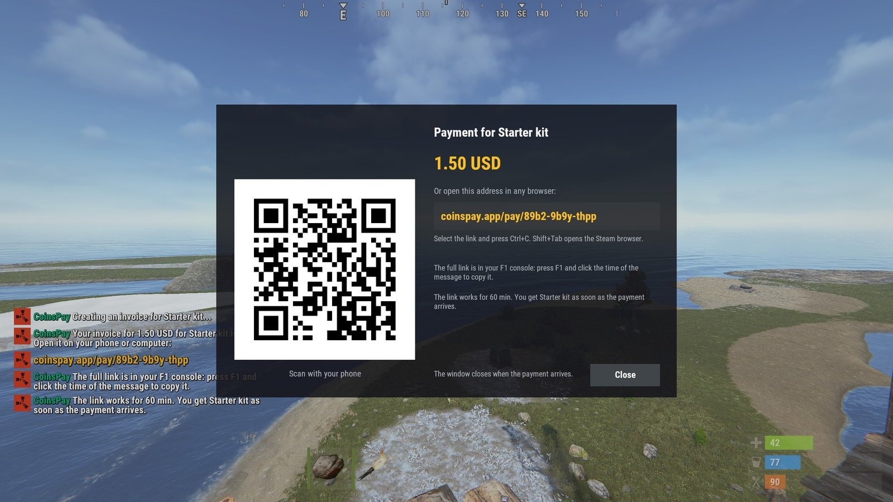
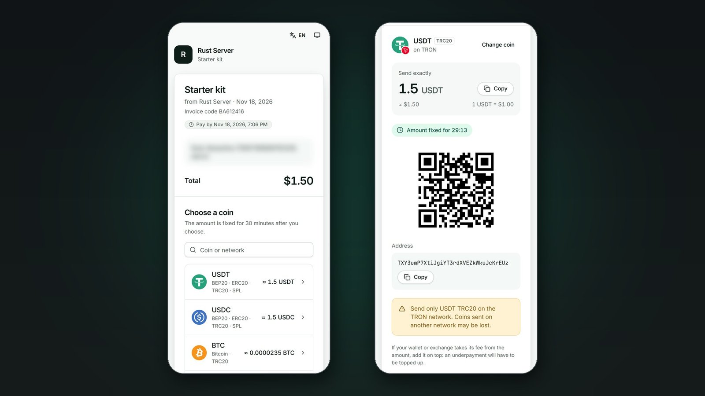
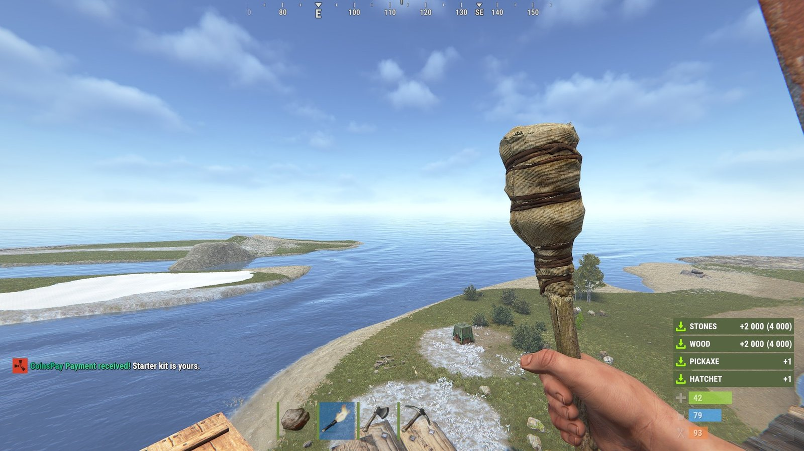

# CoinsPay for Rust

Sell VIP, kits, items and in-game currency on your Rust server for crypto. A player types
`/donate`, picks an item and pays on the CoinsPay payment page. The plugin then delivers the item:
groups, permissions, items or console commands. The money goes straight to your wallets, with fees
as low as 0.3%.



## Requirements

One file, `CoinsPay.cs`, for both frameworks.

| | Tested on |
|---|---|
| Oxide (uMod) | 2.0.7900, 2.0.7909 |
| Carbon | 2.0.264 |
| Rust | November 2026 update (protocol 2636) |

You also need a [CoinsPay](https://coinspay.app) account with a shop.

## Quick start

1. Download `CoinsPay.cs` from [Releases](https://github.com/coinspayapp/coinspay-rust/releases/latest).
2. In the CoinsPay dashboard open your shop → "API keys" → "Create key", access **"Invoices only"**.
3. Put `CoinsPay.cs` into `oxide/plugins` (Carbon: `carbon/plugins`). The framework compiles and
   loads it, and writes the config: `oxide/config/CoinsPay.json` (Carbon: `carbon/configs/CoinsPay.json`).
4. Paste the key into `"api"` → `"key"`, describe your items under `"packages"`
   ([example](#items)), and run `coinspay.reload` in the server console.
5. `coinspay.status` shows your shop and the key. Players can now type `/donate`.

Full installation guides: [English](docs/install-en.md) · [Русский](docs/install-ru.md).

**Test mode.** Create a test key (`cpk_test_…`) to try the store first. The payment page of a
test invoice has a "Pay" button, no coins move, and the plugin delivers the item as usual.

## How it works

1. `/donate` opens the store window. With `"menu": "chat"` it prints a list instead, and the player
   types `/donate <item>`.
2. A click creates a CoinsPay invoice. Rust chat has no clickable links, so the player gets three
   ways to open the payment page:
   - a QR code in the payment window, to scan with a phone;
   - a short address such as `coinspay.app/pay/k7m2-x9pq-4tza`, in the window and in chat, to type
     into any browser;
   - the full link in the F1 console: press F1 and click the time of the message to copy it.
3. The player pays in USDT, BTC, ETH, TRX, BNB, LTC, SOL and more on the CoinsPay page, in their
   language.
4. Within seconds of the payment the plugin delivers the item and closes the payment window.
   Items for the inventory wait until the player is in the game, awake and alive.







The plugin asks the CoinsPay API about payments every few seconds, so the server needs no public
address or webhook.

### Coins and prices

Players pay with more than 30 coins and tokens on TRON, Ethereum, BNB Smart Chain, Solana,
Bitcoin and Litecoin, among them USDT, USDC, BTC, ETH, BNB, TRX, LTC and SOL. The full list is on
[coinspay.app/coins](https://coinspay.app/coins).

You set prices in USD, EUR, RUB or another currency CoinsPay accepts. CoinsPay converts the price
at the current rate and holds the coin amount for 30 minutes while the player opens their wallet.

### Why CoinsPay

- **The plugin is free.** CoinsPay takes a fee on payouts only: as low as 0.3%, lower as your
  volume grows, with no monthly fee. For the first 10 days after the first payment, payouts up to
  $500 carry no fee.
- **The money is yours at once.** Every payment goes on to your wallets, up to 5 per network with
  shares, say 70% to you and 30% to a partner.
- **No chargebacks.** A crypto payment cannot be reversed by a bank, so a delivered VIP stays
  paid for.
- **The fee can be passed to the buyer** (`"buyer-pays-fee": true`).

## Items

```json
"packages": {
  "vip-30": {
    "name": "VIP for 30 days",
    "description": ["The vip group: its kits and perks"],
    "price": "4.99",
    "duration": "30d",
    "groups": ["vip"]
  },
  "wood": {
    "name": "10 000 wood",
    "price": "1.00",
    "items": [{ "shortname": "wood", "amount": 10000 }]
  },
  "coins": {
    "name": "1 000 coins",
    "price": "2.00",
    "commands": ["deposit {steamid} 1000"]
  }
}
```

- **`groups` and `permissions`** go through the framework's permission system, so the player does
  not need to be online. With `duration` (`30d`, `12h`, `90m`, `2w`, `1mo`) the plugin takes them
  back when the time ends, and buying again extends it. A group or permission the player had
  before the purchase is never taken back. A missing group is created.
- **`items`** are Rust item shortnames. They wait until the player is in the game; what does not
  fit in the inventory drops at the player's feet. DLC items and paid skins are refused: Facepunch
  forbids giving them to players who did not buy them.
- **`commands`** run in the server console: Economics (`deposit {steamid} 1000`), Server Rewards
  (`rp add {steamid} 1000`), Kits (`kit give {steamid} starter`) and any other plugin. Add
  `"require-online": true` when a command needs the player in the game, as `kit give` does.
  `expire-commands` run when the `duration` ends.

Placeholders: `{steamid}`, `{name}`, `{item}` (the item id), `{amount}` and `{currency}` (the price),
`{invoice}`. Prefer `{steamid}`: Rust names may hold any characters, so `{name}` loses quotes and
semicolons.

## Settings

| Key | Default | |
|---|---|---|
| `api.key` | | the "Invoices only" key |
| `server-id` | `main` | goes into every invoice reference; give each server its own |
| `language` | `auto` | player texts: `auto` (the player's language), `en` or `ru` |
| `currency` | `USD` | price currency; an item may set its own `currency` |
| `buyer-pays-fee`, `buyer-pays-network` | `false` | the buyer pays the CoinsPay fee and the network fee of your payout on top of the price |
| `invoice-lifetime-minutes` | `60` | how long a payment link works |
| `max-open-per-player`, `cooldown-seconds` | `2`, `10` | limits against invoice spam |
| `poll-seconds` | `10` | how often to ask CoinsPay about payments |
| `chat-commands` | `["donate"]` | the chat commands of the store |
| `menu` | `ui` | `ui` for the windows, `chat` for chat only |
| `return-url` | | where the payment page's "Back to the shop" button leads |

## Safety

- **Use an "Invoices only" API key.** It cannot make payouts, so a leaked config does not put money
  at risk. The plugin warns in the console if the key has full access.
- **What is delivered comes only from your config.** The groups, items and commands are copied into
  the order when the invoice is created. Nothing from the network is ever run as a command.
- **An item is delivered only if all of these match:** the invoice is one this server created, its
  reference, currency, amount and mode (test or live).
- **The buyer is the player who typed `/donate`.** The Steam ID comes from the session, not from
  input.
- **Each item is delivered once.** The state is written to `oxide/data/CoinsPay.json` before the
  delivery. A crash in the middle of one leaves the order for review (`coinspay.redeliver` or
  `coinspay.markdone`) and never delivers twice.
- **The certificate is checked.** Oxide and Carbon accept any TLS certificate for the whole server;
  the plugin checks the certificate of the CoinsPay API on its own requests.
- **The plugin talks only to the API address in the config,** and only about invoices. No
  analytics, no update checks.

Facepunch's [server guidelines](https://facepunch.com/legal/servers) allow selling access,
cosmetics and your own server currency, and accepting donations. They forbid giving Facepunch DLC
or paid skins to players who did not buy them. You are responsible for what your server sells.

## Commands

| Command | |
|---|---|
| `/donate [item]` | the store, for everyone |
| `coinspay.status` | key, shop, queue, last API error |
| `coinspay.pending` | unpaid, waiting and timed items |
| `coinspay.check <invoice>` | ask CoinsPay about an invoice now |
| `coinspay.redeliver <invoice>` | deliver an item again |
| `coinspay.markdone <invoice>` | mark delivered without delivering |
| `coinspay.give <player or steamid> <item>` | create an invoice for a player; for one who is offline, the link goes to the console |
| `coinspay.reload` | reread the config and texts |

The `coinspay.*` commands work in the server console and RCON. Players with the `coinspay.admin`
permission can run them in the F1 console, or in chat as `/coinspay status` and so on.

Texts: `oxide/lang/en/CoinsPay.json` and `oxide/lang/ru/CoinsPay.json` (Carbon: `carbon/lang`).

## Building

```sh
node bin/build.mjs    # dist/CoinsPay.cs from src/
sh bin/test.sh        # unit tests in Docker (dotnet SDK), no local .NET needed
```

## License

MIT. The QR code generator is a port of [Nayuki's](https://www.nayuki.io/page/qr-code-generator-library) (MIT).

Rust is a trademark of Facepunch Studios Ltd. CoinsPay is not affiliated with or endorsed by
Facepunch.
